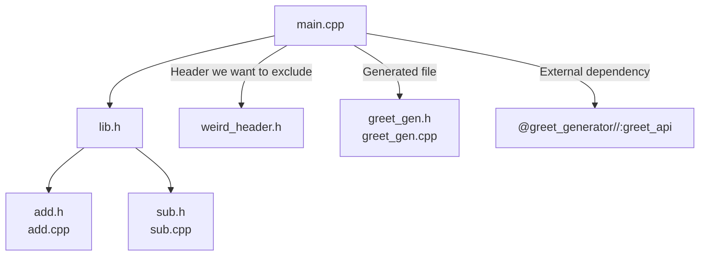

# Dependencies example

In this example, instead of specifying the files to be included in the Doxygen documentation using the `srcs` attribute with a glob, we use the `deps` attribute.
This allows us to select a target and immediately include all of the files in its `srcs` and `hdrs`, along with all of its transitive dependencies.

```bash
bazel build //dependencies:doxygen
```

## Showcase

In a very common scenario, imagine working on a C++ project with the following build file:

```bzl
# BUILD.bazel
load("@rules_cc//cc:defs.bzl", "cc_library")

cc_library(
    name = "add",
    srcs = ["add.cpp"],
    hdrs = ["add.h"],
)

cc_library(
    name = "sub",
    srcs = ["sub.cpp"],
    hdrs = ["sub.h"],
)

cc_library(
    name = "weird_lib",
    hdrs = ["weird_header.h"],
    tags = ["doxygen_skip"],
)

cc_library(
    name = "lib",
    hdrs = ["lib.h"],
    deps = [
        ":add",
        ":sub",
    ],
)

generate_greeting(
    name = "greet",
    greeting = "Hello world!",
    greeting_version = 42,
    strip_include_prefix = "//dependencies",
)

cc_library(
    name = "main",
    srcs = ["main.cpp"],
    deps = [
        ":greet",
        ":lib",
        ":weird_lib",
        "@greet_generator//:greet_api",
    ],
)
```

The graph of dependencies looks like this:



If we want to include all of the files in the documentation, we can use the `deps` attribute to collect the `main` target's files and those of its transitive dependencies, like this:

```bzl
# BUILD.bazel
load("@doxygen//:doxygen.bzl", "doxygen")

doxygen(
    name = "doxygen",
    deps = [":main"],
    doxygen_config = ":Doxyfile",
)
```

By default, only the files `lib.h`, `add.h`, `add.cpp`, `sub.h`, and `sub.cpp` will be included in the documentation, because they are part of the `main` target's transitive dependencies.
The file `weird_header.h` will be skipped because it has the `doxygen_skip` tag, and the generated file `greet_gen.h` and the external dependency `@greet_generator//:greet_api` will be skipped by default.
To change this behavior, we can use a custom aspect and rule to also document external and generated source files.

```bzl
# defs.bzl
load("@doxygen//:doxygen.bzl", "collect_files_aspect_factory", "doxygen_rule_factory")

collect_ext_and_gen_files_aspect = collect_files_aspect_factory(
    collect_external = True,  # We want to include external dependencies in our doxygen documentation.
    collect_generated = True,  # We want to include generated files in our doxygen documentation.
)

# Define and expose a custom doxygen rule that uses the above aspect to collect external and generated files.
ext_and_gen_doxygen_rule = doxygen_rule_factory(
    collect_files_aspect = collect_ext_and_gen_files_aspect,
)
```

Then we can use this custom rule in our build file to include the external and generated files in the documentation:

```bzl
# BUILD.bazel

doxygen(
    name = "doxygen_ext_and_gen",
    srcs = [
        "README.md",  # file
        ":section",  # genrule
    ],
    outs = [
        "ext_and_gen/html",
        "ext_and_gen/tags",
    ],
    doxyfile_prefix = "ext_and_gen",
    doxygen_rule = ext_and_gen_doxygen_rule,
    project_brief = "Example project for doxygen",
    project_name = "dependencies",
    use_mdfile_as_mainpage = "dependencies/README.md",
    deps = [":main"],  # cc_library
)
```
